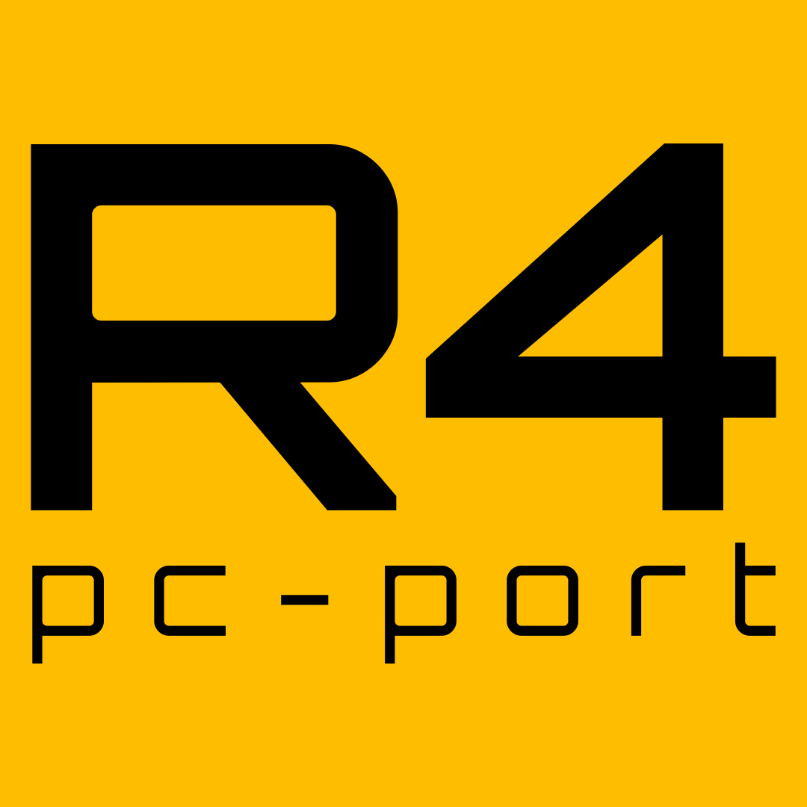

# Ridge Racer Type 4

[](https://discord.gg/hbGvPbFguk)



A native PC port of *Ridge Racer Type 4*, built from the original game code
with [our PsyZ fork](https://github.com/khasinski/ridge-racer-type-4-psyz). It runs
on macOS, Linux and Windows. This is an early alpha.

## Discord

Join the [Discord server](https://discord.gg/hbGvPbFguk) for release updates and bug reports.

## Play

Download the game from [GitHub Releases](https://github.com/khasinski/ridge-racer-type-4-pc/releases).
On Linux, take the `.AppImage` (make it executable and start it) or the
`.tar.gz` with the same executable.
See the [changelog](CHANGELOG.md) for changes.

You need your own **European (PAL) or Japanese CUE/BIN image** of the game
(SCES-01706 or SLPS-01800; the Japanese release runs at 60 Hz with its own
picture, text and saves, see [docs/REGIONS.md](docs/REGIONS.md)). Game data is
not included. Keep the CUE file next to its BIN file.

Start the game and choose the CUE file, or pass it on the command line:

```sh
./ridge-racer-type-4-pc "Ridge Racer Type 4 (Europe).cue"
```

**Keys:** arrows steer, `X` Cross, `Z` Square, `D` Circle, `S` Triangle,
`Q`/`R` L1/R1, `W`/`E` L2/R2, `Enter` Start, `Backspace` Select, `F4`
fullscreen. A gamepad works as player 1, a second one as player 2.

For analog steering choose the controller each pad emulates under
**Escape > Controls**: the original digital pad (default), a DualShock (the
left stick steers), a neGcon (the left stick twists, the right and left
triggers press I and II) or a JogCon (the left stick turns the dial). The
game's own Options then show and calibrate that controller.

**Escape** opens the settings: resolution up to 8x, fullscreen, Classic 4:3
or Widescreen 16:9, PAL or NTSC timing, frame interpolation, geometry
correction and other graphics options, controls, volume and the disc image.
Enhancements are off by default, so the game looks and plays like the
original.

Settings are saved in `ridge-racer-type-4.toml` in your user configuration
folder, or next to the executable if that file already exists there. The
memory cards are kept as `bu00`/`bu10` folders in the same folder as that
file, wherever the game is started from (cards an earlier version left in
the working folder are copied there once). Each start also writes
`ridge-racer-type-4.log` to that folder; please attach it to bug reports.

## Build

Requires Git, CMake 3.21 or newer and a C11 compiler.

```sh
git clone https://github.com/khasinski/ridge-racer-type-4-pc
cd ridge-racer-type-4-pc
git submodule update --init third_party/psyz
git -C third_party/psyz submodule update --init external/SDL
cmake -S . -B build -DCMAKE_BUILD_TYPE=RelWithDebInfo
cmake --build build --parallel
./build/ridge-racer-type-4-pc
```

On macOS, `-DRR4_MACOS_BUNDLE=ON` builds `Ridge Racer Type 4.app`.

For development, testing and releases, see [contributing](CONTRIBUTING.md),
[architecture](docs/ARCHITECTURE.md), [conventions](docs/CONVENTIONS.md) and
[releasing](docs/RELEASING.md); known bugs and debt are tracked in
[technical debt](docs/TECH_DEBT.md). Test and diagnostic options are listed at the
top of `src/port/diagnostics.c`.

This repository contains source only. Disc images and proprietary SDK files
are not distributed.
